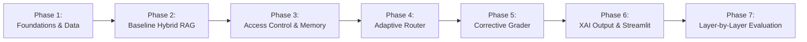

# Phased Implementation Plan

**Project:** Enterprise RAG Assistant for Banking Regulatory Compliance  
**Module:** COM6301 (BSc Final Year Project)  
**Status:** Step 1 Master Plan (Updated for Profile-Driven LLM Gateway, Spend Guard & Local CPU Models)  

---

## Roadmap Overview

---

## Phase 1: Foundations & Data Preparation

### Goal
Establish project dependencies, SQLite database with migrations and seeds, synthetic regulatory documents, synthetic user directory, `.env.example`, `.gitignore`, and the initial 100-question gold benchmark set.

### Concrete Tasks
1. Initialize `.gitignore` (ignoring `.env`, `data/sqlite/*.db`, `data/qdrant/`, `data/cache/`, `.venv/`, `__pycache__/`, `.pytest_cache/`).
2. Create and verify `requirements.txt` with pinned versions and justification comments, plus `requirements-dev.txt`.
3. Create `.env.example` containing the `mock` / `dev` / `demo` profile blocks, base URLs, model names, timeout/retry/rate-limit settings, prompt version, spend-guard caps, and ablation flags.
4. Build `src/config.py` using Pydantic `BaseSettings` to validate environment variables and resolve `LLM_PROFILE` into one `llm` settings object. Unknown or incomplete profiles must fail fast with a sanitized message; `demo` must never borrow `dev` credentials.
5. Implement `src/db/connection.py` and `src/db/migrations.py` to create SQLite schema (roles, users, sessions, messages, audit_log, llm_calls, documents, plus the `llm_cache` response table).
6. Generate synthetic internal bank documents in `/data/synthetic/` with explicit role boundaries (`SOP-KYC-001.md`, `POLICY-SUPERVISORY-002.md`, `AUDIT-LIQUIDITY-2025.md`).
7. Populate public regulatory sample documents in `/data/raw/` (e.g. FCA BCOBS / MLR regulations).
8. Create `scripts/seed_data.py` to insert synthetic roles, users, and documents into SQLite.
9. Author the 100-question benchmark set in `data/gold_set.json` (single-fact, multi-part, role-restricted, unanswerable).
10. Implement mock LLM fixtures in `tests/conftest.py` ensuring all automated tests run under `LLM_PROFILE=mock` with 0 external API calls, and fail fast if a live profile is ever resolved.

### Files Affected
- `.gitignore`
- `requirements.txt`
- `requirements-dev.txt`
- `.env.example`
- `src/config.py`
- `src/db/connection.py`
- `src/db/migrations.py`
- `src/db/repository.py`
- `scripts/seed_data.py`
- `data/synthetic/*`
- `data/raw/*`
- `data/gold_set.json`
- `tests/conftest.py`
- `tests/test_db.py`
- `tests/test_config.py`
- `tests/test_data_validation.py`

### Automated Tests
- `tests/test_db.py`: Verifies foreign key constraints, WAL mode, user seeding, llm_calls metrics, and parameterized queries.
- `tests/test_config.py`: Verifies `dev`/`demo`/`mock` profile resolution, rejection of unknown or incomplete profiles, and that a live profile can never resolve under pytest.
- `tests/test_data_validation.py`: Verifies that `gold_set.json` validates against the schema and contains 100 items with valid clause IDs.

### Completion Criteria
- Running `python scripts/seed_data.py` creates `./data/sqlite/app.db` without errors.
- `python -c "from src.config import settings; print(settings.llm.profile)"` reports the profile from `.env`.
- All unit tests in `tests/test_db.py`, `tests/test_config.py` and `tests/test_data_validation.py` pass.
- Zero API quota consumed during tests.

---

## Phase 2: Ingestion Pipeline & Baseline Hybrid RAG

### Goal
Implement clause-aware document chunking, hybrid retrieval (BM25 + Qdrant embedded dense vectors) with Reciprocal Rank Fusion, cross-encoder re-ranking on CPU, and baseline standard RAG generation through the single profile-driven LLM wrapper (profiles, caching, spend guard, token telemetry).

### Concrete Tasks
1. Build `src/ingestion/loader.py` for reading markdown and PDF files with header preservation.
2. Build `src/ingestion/chunker.py` to split documents hierarchically by clause, article, and section, tagging each chunk with `allowed_roles`.
3. Implement `src/retrieval/bm25.py` for in-memory keyword search.
4. Implement `src/retrieval/vector_store.py` wrapping Qdrant embedded client with `BAAI/bge-small-en-v1.5` embeddings on CPU.
5. Implement `src/retrieval/hybrid.py` for Reciprocal Rank Fusion ($k=60$) combining BM25 and vector scores.
6. Implement `src/retrieval/reranker.py` using `cross-encoder/ms-marco-MiniLM-L-6-v2` on CPU to score top-20 candidates down to top-5.
7. Build `src/core/llm_client.py` as the **only** LLM entry point: resolves `LLM_PROFILE` (`mock` | `dev` | `demo`), applies 15s timeout, exponential backoff with jitter, token-bucket RPM limiting, and optional dev-only failover.
8. Build `src/core/llm_cache.py` as a thin wrapper over the repository's `llm_cache` table (key = SHA-256 of model + prompt + parameters, including profile and prompt version) and `src/core/spend_guard.py` (per-run call and token caps with a clear stop message). Implement the `mock` provider returning deterministic canned outputs.
9. Create the versioned prompt registry: `prompts/answer/v1.md` and `prompts/rewrite/v1.md`, loaded by a small loader that validates `PROMPT_VERSION` and exposes the version for cache keys and audit rows.
10. Implement per-call token telemetry into the `llm_calls` metrics table (step, profile, model, prompt version, tokens, cached, latency, flags).
11. Build `src/core/pipeline.py` implementing baseline generation (single LLM prompt with retrieved chunks).
12. Create `scripts/run_ingestion.py` to parse all raw/synthetic documents and index them into Qdrant and BM25.
13. Create `scripts/smoke_demo.py` with 10 representative questions (extended with role/refusal cases as later layers land), printing pass/fail, latency, tokens, route and cache status; `--profile` overrides `.env` for the run.
14. **Measure Baseline Latency and Tokens per Query:** Record prompt tokens, completion tokens, and latency for baseline queries.

### Files Affected
- `src/ingestion/loader.py`
- `src/ingestion/chunker.py`
- `src/ingestion/indexer.py`
- `src/retrieval/bm25.py`
- `src/retrieval/vector_store.py`
- `src/retrieval/hybrid.py`
- `src/retrieval/reranker.py`
- `src/core/llm_client.py`
- `src/core/llm_cache.py`
- `src/core/spend_guard.py`
- `src/core/prompts.py`
- `src/core/pipeline.py`
- `prompts/answer/v1.md`
- `prompts/rewrite/v1.md`
- `scripts/run_ingestion.py`
- `scripts/smoke_demo.py`

### Automated Tests
- `tests/test_chunker.py`: Verifies clause metadata retention and role tagging.
- `tests/test_retrieval.py`: Tests BM25, vector search, RRF fusion, and cross-encoder ranking.
- `tests/test_llm_client.py`: Tests profile resolution, cache hit/miss keys, spend-guard exhaustion, retry/backoff logic, and token telemetry using the `mock` provider.
- `tests/test_baseline_pipeline.py`: Tests baseline generation with the `mock` provider.

### Completion Criteria
- Ingestion script processes corpus and populates Qdrant and SQLite document catalog.
- Baseline pipeline executes end-to-end on test queries under all three profiles (mock unconditionally; dev/demo via manual smoke).
- Baseline token consumption and latency metrics recorded per call.
- `python scripts/smoke_demo.py --profile mock` passes 10/10 with 0 external tokens.

---

## Phase 3: Access Control & Conversational Memory

### Goal
Enforce server-side role-based access filtering in Qdrant and BM25 at retrieval time, implement session-based conversation memory in SQLite, and track memory-injected token overhead.

### Concrete Tasks
1. Build `src/core/security.py` to resolve role permissions (`analyst`, `manager`, `auditor`) into deterministic Qdrant payload filters and BM25 candidate filters.
2. Integrate security filters directly into `src/retrieval/vector_store.py` and `src/retrieval/bm25.py`.
3. Implement `src/core/memory.py` to fetch recent turns for active `session_id` and append conversation context.
4. Add query condensation logic if conversational context contains pronominal references.
5. Create automated security test suite `tests/test_rbac_security.py` probing unauthorized access boundaries.
6. **Measure Memory Layer Latency & Tokens:** Quantify the incremental token cost of carrying session history into queries.

### Files Affected
- `src/core/security.py`
- `src/core/memory.py`
- `src/retrieval/vector_store.py`
- `src/retrieval/bm25.py`
- `src/core/pipeline.py`
- `tests/test_rbac_security.py`

### Automated Tests
- `tests/test_rbac_security.py`: Simulates `analyst` query for `manager`-only and `auditor`-only documents. Asserts 0 matching chunks retrieved and zero unauthorized terms leaked.
- `tests/test_memory.py`: Verifies multi-turn message persistence in SQLite.

### Completion Criteria
- Security penetration suite passes with exactly **0.00% leakage rate**.
- Multi-turn conversation context preserved in SQLite.

---

## Phase 4: Layer 1 - Adaptive Router

### Goal
Implement the Adaptive Router to classify queries into direct replies, single searches, or sub-question decompositions, avoiding unnecessary retrieval and handling compound questions.

### Concrete Tasks
1. Build `src/core/router.py` with the strict JSON prompt at `prompts/router/v1.md`, defining routes: `DIRECT_REPLY`, `SINGLE_SEARCH`, `MULTI_PART_SPLIT`.
2. Validate router decisions with a strict Pydantic model (`extra="forbid"`), allowing exactly **one repair retry** that feeds the validation error back to the model; on a second failure, fall back deterministically to `SINGLE_SEARCH` and set `fallback_used=true`.
3. Implement query decomposition handler for `MULTI_PART_SPLIT`: generates 2–3 sub-questions, executes parallel searches, and deduplicates retrieved chunk sets.
4. Wire router into `src/core/pipeline.py` behind the `ENABLE_ADAPTIVE_ROUTER` flag.
5. **Measure Router Latency and Tokens:** Quantify token savings on greetings (direct reply) vs extra tokens consumed during decomposition, including repair-retry overhead.

### Files Affected
- `src/core/router.py`
- `src/core/pipeline.py`
- `src/api/schemas.py`
- `prompts/router/v1.md`
- `tests/test_router.py`

### Automated Tests
- `tests/test_router.py`: Tests router accuracy against labelled test queries, one-repair recovery from malformed JSON, and deterministic `SINGLE_SEARCH` fallback after a second failure (mock profile only).

### Completion Criteria
- Router achieves $> 90\%$ classification accuracy on a 30-query validation subset.
- Greetings bypass retrieval, saving ~90% tokens and latency.
- Malformed JSON never escapes the router: repaired or degraded to `SINGLE_SEARCH`, and visible in the reasoning trace.

---

## Phase 5: Layer 2 - Corrective Grader & Single Retry Loop

### Goal
Implement passage relevance grading, automated query rewriting upon poor retrieval, and polite refusal when evidence remains insufficient.

### Concrete Tasks
1. Build `src/core/grader.py` with the strict JSON prompt at `prompts/grader/v1.md`, evaluating relevance of retrieved passages against the query.
2. Validate grader output with a strict Pydantic model, allowing exactly **one repair retry**; if the second attempt is still invalid, fall back to "keep all passages" (no passage dropped) and set `fallback_used=true`.
3. Implement query rewriter (using `prompts/rewrite/v1.md`) to reformulate ambiguous search queries if initial relevance score $< \text{threshold}$ (default $0.65$).
4. Implement conditional retry loop in `src/core/pipeline.py` (maximum 1 retry) controlled by `ENABLE_CORRECTIVE_GRADER`.
5. Implement standard polite refusal generator when second-pass retrieval remains irrelevant.
6. **Measure Grader Latency and Tokens:** Record extra tokens consumed by grading calls, repair retries, and query rewrites.

### Files Affected
- `src/core/grader.py`
- `src/core/pipeline.py`
- `prompts/grader/v1.md`
- `prompts/rewrite/v1.md`
- `tests/test_grader.py`

### Automated Tests
- `tests/test_grader.py`: Verifies grading accuracy, one-repair recovery, keep-all-passages fallback, single retry loop termination, and polite refusal on unanswerable queries (mock profile only).

### Completion Criteria
- Correct Refusal Rate on unanswerable queries reaches $\ge 90\%$.
- Query rewrite retry improves retrieval score on ambiguous test queries.
- Malformed grader JSON degrades to keeping passages, never to silently dropping evidence.

---

## Phase 6: Layer 4 - Explainable Output (XAI) & Streamlit Demo UI

### Goal
Implement clause-level citation extraction, reasoning trace logging, persistent SQLite audit logging, FastAPI REST endpoints, and a multi-role Streamlit demonstration UI.

### Concrete Tasks
1. Build `src/core/xai.py` to extract clause citations (`[DocName, ClauseID]`) and compile reasoning traces.
2. Implement anti-hallucination citation guard ensuring cited clauses exist in retrieved chunks.
3. Implement audit trail logger inserting interaction metadata into SQLite `audit_log` table.
4. Build FastAPI endpoints in `src/api/` (`/api/v1/chat/query`, `/api/v1/sessions`, `/api/v1/audit/logs`, `/api/v1/admin/health`).
5. Build Streamlit web application (`src/ui/app.py`):
   - Role switcher dropdown (`Analyst`, `Manager`, `Auditor`).
   - Chat session interface with message history.
   - Interactive citation drawer displaying cited clause snippets.
   - Collapsible reasoning trace viewer and Auditor-only audit log dashboard.
6. **Measure XAI Latency and Token Overhead:** Track formatting token overhead of citation annotations and audit traces.
7. Extend `scripts/smoke_demo.py` with the final 10 representative questions across all layers (greeting, single-fact, multi-part, role-restricted, unanswerable) and show the active profile plus cache status per row.

### Files Affected
- `src/core/xai.py`
- `src/db/repository.py`
- `src/api/main.py`
- `src/api/routes.py`
- `src/api/schemas.py`
- `src/ui/app.py`
- `scripts/smoke_demo.py`
- `tests/test_api.py`

### Automated Tests
- `tests/test_xai.py`: Verifies citation parsing and hallucination detection.
- `tests/test_api.py`: Tests all FastAPI endpoints, status codes, input validations, and role restrictions.

### Completion Criteria
- Streamlit UI runs locally on `http://localhost:8501`, connecting cleanly to FastAPI on `http://127.0.0.1:8000`.
- Users can switch roles in UI and immediately experience permission boundaries and citation drawers.
- Every chat turn records a complete audit log entry in SQLite.

---

## Phase 7: Layer-by-Layer Evaluation, Ablation Benchmark & Write-Up

### Goal
Execute the 100-question benchmark layer by layer across all 5 configurations with rate-limit handling and result caching, record all metrics (Recall, MRR, RAGAS, CRR, Leakage, Latency, Tokens), hand-check 20% sample, and export publication-ready tables.

### Concrete Tasks
1. Build `scripts/run_evaluation.py` supporting layer-by-layer execution, `--profile mock|dev|demo`, temperature 0, batching (5 items/batch), rate-limit delay, persistent result caching to disk, `--resume`, and spend-guard-aware abort handling.
2. Write `llm_profile`, `llm_model`, `prompt_version`, `temperature`, `config_hash` and `run_id` into the run manifest and **every** per-question result row/artifact (JSONL, CSV, summary JSON, LaTeX).
3. Execute Run 0 (Baseline) against 100 gold questions; record baseline metrics.
4. Execute Run 1 (+ Adaptive Router); record metrics.
5. Execute Run 2 (+ Corrective Grader); record metrics.
6. Execute Run 3 (+ Memory & RBAC); record metrics and verify 0.00% leakage rate.
7. Execute Run 4 (Full System + XAI); record metrics and token overhead.
8. Perform manual hand-check on 20 randomly sampled queries to validate judge scores.
9. Generate summary CSV, JSON, and LaTeX formatted tables for COM6301 dissertation.

### Files Affected
- `scripts/run_evaluation.py`
- `evaluation/results/<run_id>/run_manifest.json`
- `evaluation/results/<run_id>/answers.jsonl`
- `evaluation/results/ablation_matrix.csv`
- `evaluation/results/ablation_summary.json`
- `evaluation/results/dissertation_tables.tex`

### Automated Tests
- `tests/test_evaluation_harness.py`: Verifies resume skips completed IDs, rejects a profile/config mismatch, and writes profile metadata into every result artifact (mock profile only).

### Completion Criteria
- Complete ablation results matrix generated, each file carrying the active `llm_profile`.
- Resume after interruption works without recomputing completed questions or mixing profiles.
- Zero data leakage confirmed.
- Hand-check sample completed and documented.
- LaTeX tables generated and ready for dissertation.
