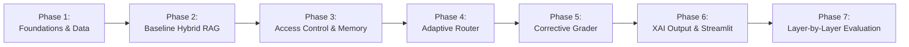

# Phased Implementation Plan

**Project:** Enterprise RAG Assistant for Banking Regulatory Compliance  
**Module:** COM6301 (BSc Final Year Project)  
**Status:** Step 1 Master Plan (Updated for Profile-Driven LLM Gateway, Spend Guard & Local CPU Models)  

---

## Roadmap Overview

---

## Phase 1: Foundations & Data Preparation

### Goal
Establish project dependencies, SQLite database with migrations and seeds, synthetic regulatory documents, synthetic user directory, `.env.example`, `.gitignore`, and the initial 100-question gold benchmark set.

### Concrete Tasks
1. [x] Initialize `.gitignore` (ignoring `.env`, `data/sqlite/*.db`, `data/qdrant/`, `data/cache/`, `.venv/`, `__pycache__/`, `.pytest_cache/`).
2. [x] Create and verify `requirements.txt` with pinned versions and justification comments, plus `requirements-dev.txt`.
3. [x] Create `.env.example` containing the `mock` / `dev` / `demo` profile blocks, base URLs, model names, timeout/retry/rate-limit settings, prompt version, spend-guard caps, and ablation flags.
4. [x] Build `src/config.py` using Pydantic `BaseSettings` to validate environment variables and resolve `LLM_PROFILE` into one `llm` settings object. Unknown or incomplete profiles must fail fast with a sanitized message; `demo` must never borrow `dev` credentials.
5. [x] Implement `src/db/connection.py` and `src/db/migrations.py` to create SQLite schema (roles, users, sessions, messages, audit_log, llm_calls, documents, plus the `llm_cache` response table).
6. [x] Generate synthetic internal bank documents in `/data/synthetic/` with explicit role boundaries (`SOP-KYC-001.md`, `POLICY-SUPERVISORY-002.md`, `AUDIT-LIQUIDITY-2025.md`).
7. [x] Populate public regulatory sample documents in `/data/raw/` (e.g. FCA BCOBS / MLR regulations).
8. [x] Create `scripts/seed_data.py` to insert synthetic roles, users, and documents into SQLite.
9. [x] Author the 100-question benchmark set in `data/gold_set.json` (single-fact, multi-part, role-restricted, unanswerable).
10. [x] Implement mock LLM fixtures in `tests/conftest.py` ensuring all automated tests run under `LLM_PROFILE=mock` with 0 external API calls, and fail fast if a live profile is ever resolved.

### Files Affected
- `.gitignore`
- `requirements.txt`
- `requirements-dev.txt`
- `.env.example`
- `src/config.py`
- `src/db/connection.py`
- `src/db/migrations.py`
- `src/db/repository.py`
- `scripts/seed_data.py`
- `data/synthetic/*`
- `data/raw/*`
- `data/gold_set.json`
- `tests/conftest.py`
- `tests/test_db.py`
- `tests/test_config.py`
- `tests/test_data_validation.py`

### Automated Tests
- `tests/test_db.py`: Verifies foreign key constraints, WAL mode, user seeding, llm_calls metrics, and parameterized queries.
- `tests/test_config.py`: Verifies `dev`/`demo`/`mock` profile resolution, rejection of unknown or incomplete profiles, and that a live profile can never resolve under pytest.
- `tests/test_data_validation.py`: Verifies that `gold_set.json` validates against the schema and contains 100 items with valid clause IDs.

### Completion Criteria
- Running `python scripts/seed_data.py` creates `./data/sqlite/app.db` without errors.
- `python -c "from src.config import settings; print(settings.llm.profile)"` reports the profile from `.env`.
- All unit tests in `tests/test_db.py`, `tests/test_config.py` and `tests/test_data_validation.py` pass.
- Zero API quota consumed during tests.

---

## Phase 2: Ingestion Pipeline & Baseline Hybrid RAG

### Goal
Implement clause-aware document chunking, hybrid retrieval (BM25 + Qdrant embedded dense vectors) with Reciprocal Rank Fusion, cross-encoder re-ranking on CPU, and baseline standard RAG generation through the single profile-driven LLM wrapper (profiles, caching, spend guard, token telemetry).

### Concrete Tasks
1. [x] Build `src/ingestion/loader.py` for reading markdown and PDF files with header preservation.
2. [x] Build `src/ingestion/chunker.py` to split documents hierarchically by clause, article, and section, tagging each chunk with `allowed_roles`.
3. [x] Implement `src/retrieval/bm25.py` for in-memory keyword search.
4. [x] Implement `src/retrieval/vector_store.py` wrapping Qdrant embedded client with `BAAI/bge-small-en-v1.5` embeddings on CPU.
5. [x] Implement `src/retrieval/hybrid.py` for Reciprocal Rank Fusion ($k=60$) combining BM25 and vector scores.
6. [x] Implement `src/retrieval/reranker.py` using `cross-encoder/ms-marco-MiniLM-L-6-v2` on CPU to score top-20 candidates down to top-5.
7. [x] Build `src/core/llm_client.py` as the **only** LLM entry point: resolves `LLM_PROFILE` (`mock` | `dev` | `demo`), applies 15s timeout, exponential backoff with jitter, token-bucket RPM limiting, and optional dev-only failover.
8. [x] Build `src/core/llm_cache.py` as a thin wrapper over the repository's `llm_cache` table (key = SHA-256 of model + prompt + parameters, including profile and prompt version) and `src/core/spend_guard.py` (per-run call and token caps with a clear stop message). Implement the `mock` provider returning deterministic canned outputs.
9. [x] Create the versioned prompt registry: `prompts/answer/v1.md` and `prompts/rewrite/v1.md`, loaded by a small loader that validates `PROMPT_VERSION` and exposes the version for cache keys and audit rows.
10. [x] Implement per-call token telemetry into the `llm_calls` metrics table (step, profile, model, prompt version, tokens, cached, latency, flags).
11. [x] Build `src/core/pipeline.py` implementing baseline generation (single LLM prompt with retrieved chunks).
12. [x] Create `scripts/run_ingestion.py` to parse all raw/synthetic documents and index them into Qdrant and BM25.
13. [x] Create `scripts/smoke_demo.py` with 10 representative questions (extended with role/refusal cases as later layers land), printing pass/fail, latency, tokens, route and cache status; `--profile` overrides `.env` for the run.
14. [x] **Measure Baseline Latency and Tokens per Query:** Record prompt tokens, completion tokens, and latency for baseline queries.

### Files Affected
- `src/ingestion/loader.py`
- `src/ingestion/chunker.py`
- `src/ingestion/indexer.py`
- `src/retrieval/bm25.py`
- `src/retrieval/vector_store.py`
- `src/retrieval/hybrid.py`
- `src/retrieval/reranker.py`
- `src/core/llm_client.py`
- `src/core/llm_cache.py`
- `src/core/spend_guard.py`
- `src/core/prompts.py`
- `src/core/pipeline.py`
- `prompts/answer/v1.md`
- `prompts/rewrite/v1.md`
- `scripts/run_ingestion.py`
- `scripts/smoke_demo.py`

### Automated Tests
- `tests/test_chunker.py`: Verifies clause metadata retention and role tagging.
- `tests/test_retrieval.py`: Tests BM25, vector search, RRF fusion, and cross-encoder ranking.
- `tests/test_llm_client.py`: Tests profile resolution, cache hit/miss keys, spend-guard exhaustion, retry/backoff logic, and token telemetry using the `mock` provider.
- `tests/test_baseline_pipeline.py`: Tests baseline generation with the `mock` provider.

### Completion Criteria
- Ingestion script processes corpus and populates Qdrant and SQLite document catalog.
- Baseline pipeline executes end-to-end on test queries under all three profiles (mock unconditionally; dev/demo via manual smoke).
- Baseline token consumption and latency metrics recorded per call.
- `python scripts/smoke_demo.py --profile mock` passes 10/10 with 0 external tokens.

---

## Phase 3: Access Control & Conversational Memory

### Goal
Enforce server-side role-based access filtering in Qdrant and BM25 at retrieval time, implement session-based conversation memory in SQLite, and track memory-injected token overhead.

### Concrete Tasks
1. [x] Build `src/core/security.py` to resolve role permissions (`analyst`, `manager`, `auditor`) into deterministic Qdrant payload filters and BM25 candidate filters.
2. [x] Integrate security filters directly into `src/retrieval/vector_store.py` and `src/retrieval/bm25.py`.
3. [x] Implement `src/core/memory.py` to fetch recent turns for active `session_id` and append conversation context.
4. [x] Add query condensation logic if conversational context contains pronominal references.
5. [x] Create automated security test suite `tests/test_rbac_security.py` probing unauthorized access boundaries.
6. [x] **Measure Memory Layer Latency & Tokens:** Quantify the incremental token cost of carrying session history into queries.

### Files Affected
- `src/core/security.py`
- `src/core/memory.py`
- `src/retrieval/vector_store.py`
- `src/retrieval/bm25.py`
- `src/core/pipeline.py`
- `tests/test_rbac_security.py`

### Automated Tests
- `tests/test_rbac_security.py`: Simulates `analyst` query for `manager`-only and `auditor`-only documents. Asserts 0 matching chunks retrieved and zero unauthorized terms leaked.
- `tests/test_memory.py`: Verifies multi-turn message persistence in SQLite.

### Completion Criteria
- Security penetration suite passes with exactly **0.00% leakage rate**.
- Multi-turn conversation context preserved in SQLite.

---

## Phase 4: Layer 1 - Adaptive Router

### Goal
Implement the Adaptive Router to classify queries into direct replies, single searches, or sub-question decompositions, avoiding unnecessary retrieval and handling compound questions.

### Concrete Tasks
1. [x] Build `src/core/router.py` with the strict JSON prompt at `prompts/router/v1.md`, defining routes: `DIRECT_REPLY`, `SINGLE_SEARCH`, `MULTI_PART_SPLIT`.
2. [x] Validate router decisions with a strict Pydantic model (`extra="forbid"`), allowing exactly **one repair retry** that feeds the validation error back to the model; on a second failure, fall back deterministically to `SINGLE_SEARCH` and set `fallback_used=true`.
3. [x] Implement query decomposition handler for `MULTI_PART_SPLIT`: generates 2–3 sub-questions, executes parallel searches, and deduplicates retrieved chunk sets.
4. [x] Wire router into `src/core/pipeline.py` behind the `ENABLE_ADAPTIVE_ROUTER` flag.
5. [x] **Measure Router Latency and Tokens:** Quantify token savings on greetings (direct reply) vs extra tokens consumed during decomposition, including repair-retry overhead.

### Files Affected
- `src/core/router.py`
- `src/core/pipeline.py`
- `src/api/schemas.py`
- `prompts/router/v1.md`
- `tests/test_router.py`

### Automated Tests
- `tests/test_router.py`: Tests router accuracy against labelled test queries, one-repair recovery from malformed JSON, and deterministic `SINGLE_SEARCH` fallback after a second failure (mock profile only).

### Completion Criteria
- Router achieves $> 90\%$ classification accuracy on a 30-query validation subset.
- Greetings bypass retrieval, saving ~90% tokens and latency.
- Malformed JSON never escapes the router: repaired or degraded to `SINGLE_SEARCH`, and visible in the reasoning trace.

---

## Phase 5: Layer 2 - Corrective Grader & Single Retry Loop [Completed]

### Goal
Implement passage relevance grading, automated query rewriting upon poor retrieval, and polite refusal when evidence remains insufficient.

### Concrete Tasks
1. [x] Build `src/core/grader.py` with the strict JSON prompt at `prompts/grader/v1.md`, evaluating relevance of retrieved passages against the query.
2. [x] Validate grader output with a strict Pydantic model, allowing exactly **one repair retry**; if the second attempt is still invalid, fall back to "keep all passages" (no passage dropped) and set `fallback_used=true`.
3. [x] Implement query rewriter (using `prompts/rewrite/v1.md`) to reformulate ambiguous search queries if initial relevance score $< \text{threshold}$ (default $0.65$).
4. [x] Implement conditional retry loop in `src/core/pipeline.py` (maximum 1 retry) controlled by `ENABLE_CORRECTIVE_GRADER`.
5. [x] Implement standard polite refusal generator when second-pass retrieval remains irrelevant.
6. [x] **Measure Grader Latency and Tokens:** Record extra tokens consumed by grading calls, repair retries, and query rewrites.

### Files Affected
- `src/core/grader.py`
- `src/core/pipeline.py`
- `prompts/grader/v1.md`
- `prompts/rewrite/v1.md`
- `tests/test_grader.py`

### Automated Tests
- `tests/test_grader.py`: Verifies grading accuracy, one-repair recovery, keep-all-passages fallback, single retry loop termination, and polite refusal on unanswerable queries (mock profile only).

### Completion Criteria
- Correct Refusal Rate on unanswerable queries reaches $\ge 90\%$.
- Query rewrite retry improves retrieval score on ambiguous test queries.
- Malformed grader JSON degrades to keeping passages, never to silently dropping evidence.

---

## Phase 6: Layer 4 - Explainable Output (XAI) & Streamlit Demo UI [Completed]

### Goal
Implement clause-level citation extraction, reasoning trace logging, persistent SQLite audit logging, FastAPI REST endpoints, and a multi-role Streamlit demonstration UI.

### Concrete Tasks
1. [x] Build `src/core/xai.py` to extract clause citations (`[DocName, ClauseID]`), validate cited `chunk_id`s against role-permitted context, and compile safe 6-step reasoning traces.
2. [x] Implement anti-hallucination citation guard ensuring cited clauses exist in retrieved chunks and are permitted for the user's role (`citations_dropped` counter).
3. [x] Implement structure-aware `heading_path` in `src/ingestion/chunker.py` and `src/ingestion/indexer.py` behind `ENABLE_HEADING_PATH` (default `true`), plus additive audit columns (`citation_count`, `citations_dropped`, `heading_path_enabled`).
4. [x] Build FastAPI endpoints in `src/api/` (`/api/v1/chat/query`, `/api/v1/sessions`, `/api/v1/audit/logs`, `/api/v1/admin/health`) and `scripts/eval_citations.py`.
5. [x] Build Streamlit web application (`DESIGN.md`, `.streamlit/config.toml`, `src/ui/api_client.py`, `src/ui/app.py`):
   - Login screen with server-verified role badge (`Analyst`, `Manager`, `Auditor`) and `st.session_state`-only token storage.
   - Chat session interface with message history, new/open/delete session controls, and distinct refusal state.
   - Interactive citation panel displaying `doc_title`, `heading_path`, `clause`, `page`, `chunk_id`, and verbatim `quote_snippet` ($\le 200$ chars).
   - Collapsible safe reasoning trace viewer, settings panel (`mock`/`dev`/`demo` badge), and Auditor-only audit log summary view.
6. [x] **Measure XAI Citations & Support:** Verified 100% citation validity and 100% verbatim snippet support via `scripts/eval_citations.py --profile mock`.
7. [x] Create `tests/test_xai.py`, `tests/test_ui_client.py`, and `docs/UI_TEST_CHECKLIST.md`.

### Files Affected
- `src/core/xai.py`
- `src/db/repository.py`
- `src/api/main.py`
- `src/api/routes.py`
- `src/api/schemas.py`
- `src/ui/app.py`
- `scripts/smoke_demo.py`
- `tests/test_api.py`

### Automated Tests
- `tests/test_xai.py`: Verifies citation parsing and hallucination detection.
- `tests/test_api.py`: Tests all FastAPI endpoints, status codes, input validations, and role restrictions.

### Completion Criteria
- Streamlit UI runs locally on `http://localhost:8501`, connecting cleanly to FastAPI on `http://127.0.0.1:8000`.
- Users can switch roles in UI and immediately experience permission boundaries and citation drawers.
- Every chat turn records a complete audit log entry in SQLite.

---

## Phase 7: Layer-by-Layer Evaluation, Ablation Benchmark & Write-Up [Completed]

### Goal
Execute the 100-question benchmark layer by layer across all configurations (`A0_baseline`..`A5_full_xai` + `RBAC_OFF_DEMO`) with rate-limit handling and result caching, record all metrics (Recall, MRR, nDCG@5, Answer F1, Citation Validity/Support, CRR, FRR, Leakage, Routing Accuracy, Latency, Tokens), and export publication-ready tables with bootstrap 95% confidence intervals.

### Concrete Tasks
1. [x] Build `scripts/build_gold_set.py` (`--template`, `--seed-default`, `--suggest --profile dev|mock`) and `scripts/validate_gold_set.py` over `data/eval/gold_set.jsonl` (100 questions across 5 types: `single_fact`, `multi_part`, `cross_reference`, `role_restricted`, `unanswerable`, $\ge 15$ per type).
2. [x] Build `scripts/eval_retrieval.py` (zero LLM calls) evaluating `bm25_only`, `vector_only`, `hybrid_rrf`, and `hybrid_rerank` with `ENABLE_HEADING_PATH` on/off in isolated temporary indices, including `< 100` chunk warning.
3. [x] Build `scripts/run_ablation.py` supporting configurations `A0_baseline`..`A5_full_xai` + `RBAC_OFF_DEMO` (`DEMONSTRATION ONLY`), `--profile mock|dev|demo`, temperature 0, per-question JSONL checkpointing, `--resume`, `--limit`, `--judge`, `ProfileMismatchError` guard, and `--require-reviewed` review gate.
4. [x] Build `scripts/make_report_tables.py` writing `results/ablation_table.md` and `results/ablation_table.csv` with bootstrap 95% CIs, interval overlap flags vs `A0_baseline`, `routing_accuracy` rendered as `"n/a"` where router is off, separate live/cached/non-LLM refusal counts, and explicit `HARNESS CHECK ONLY (mock)` / `LIVE` banners.
5. [x] Build `scripts/corpus_manifest.py` and `docs/CORPUS_GUIDE.md` to audit document sidecars (`source`, `licence`, `allowed_roles`, chunk counts) and scaffold templates for expansion toward 20–40 documents.
6. [x] Create `tests/test_phase7_eval.py` covering metric fixtures, gold-set validator errors, ablation config isolation, profile recording, checkpoint resume, routing `n/a` rendering, cost separation, review gate, and manifest audits (16 unit tests).
7. [x] Phase 7b & 7c Integrity Fixes: expanded corpus to 24 documents (101 chunks), added `reviewed_by`/`reviewed_on` to gold-set schema, reset all 100 questions to `draft` for human review, built interactive terminal review tool `scripts/review_gold_set.py`, added mandatory `content_origin` and `licence_url` to all 24 sidecars with provenance audit warnings for condensed excerpts in `scripts/corpus_manifest.py`, and added 95% bootstrap CI columns and baseline overlap notes to dissertation LaTeX export (`results/dissertation_tables.tex`).
8. [ ] Optional live `--profile dev` / `--profile demo` benchmark execution once external LLM API credentials are configured in `.env`.

### Files Affected
- `scripts/run_evaluation.py`
- `evaluation/results/<run_id>/run_manifest.json`
- `evaluation/results/<run_id>/answers.jsonl`
- `evaluation/results/ablation_matrix.csv`
- `evaluation/results/ablation_summary.json`
- `evaluation/results/dissertation_tables.tex`

### Automated Tests
- `tests/test_evaluation_harness.py`: Verifies resume skips completed IDs, rejects a profile/config mismatch, and writes profile metadata into every result artifact (mock profile only).

### Completion Criteria
- Complete ablation results matrix generated, each file carrying the active `llm_profile`.
- Resume after interruption works without recomputing completed questions or mixing profiles.
- Zero data leakage confirmed.
- Hand-check sample completed and documented.
- LaTeX tables generated and ready for dissertation.

---

## Phase 8: Frontend Hardening & Demo Polish [Completed]

### Goal
Harden the Streamlit user interface, implement a headless AppTest automated test suite, add a 2-minute role demo preset panel, enforce high-contrast WCAG accessibility, display persistent profile warning badges, and provide a 5-minute presentation script with fallback contingency plans.

### Concrete Tasks
1. [x] **Headless AppTest Suite (`tests/test_ui_app.py`):** 11 automated tests using `streamlit.testing.v1.AppTest` covering unauthenticated login screen, login failure, login success transition, unauthorized role blocked from auditor view, auditor view access with 0.00% leakage KPI, 401 token expiration redirect, refusal card rendering, long answer multi-citation rendering, backend API down warning, session create/open/delete, and demo preset query triggers.
2. [x] **2-Minute Demo Presets:** Added `DEMO_PRESETS` in `src/ui/app.py` featuring 6 standardized questions (public CDD query, manager escalation policy, confidential KYC audit findings, multi-part Basel III vs AML split, out-of-corpus Dodd-Frank unanswerable, and adversarial prompt-injection override) executing directly via the API client.
3. [x] **Persistent LLM Profile Warning Badge:** Conspicuous warning-styled badges (`⚠️ OFFLINE MOCK • model` / `⚠️ DEV PROVIDER • model`) displayed prominently in login header, sidebar, and workspace title bar when not running live paid `demo` mode.
4. [x] **Accessibility & Contrast Pass:** Enforced `#1C1D20` Matte Black text on `#FF5F00` Safety Orange primary buttons, visible focus outlines, explicit non-empty labels for all text and number inputs, and distinct text role badges (`ROLE: ANALYST`, `ROLE: MANAGER`, `ROLE: AUDITOR`).
5. [x] **UX Hardening & Citations:** Distinct compliance refusal card with uniform wording and category badge, structured citation cards with `heading_path`, `page`, and verbatim quote snippet, and expandable reasoning trace (*"How this answer was produced — Reasoning Trace & Verification Steps"*).
6. [x] **Presentation Script & Verification Checklist:** Authored `docs/DEMO_SCRIPT.md` (5-minute timeboxed presentation script with click order, talking points, audience takeaways, and offline fallback contingency procedures) and updated `docs/UI_TEST_CHECKLIST.md`.

### Files Affected
- `src/ui/app.py`
- `tests/test_ui_app.py`
- `docs/DEMO_SCRIPT.md`
- `docs/UI_TEST_CHECKLIST.md`
- `DESIGN.md`
- `STATUS.md`
- `PLAN.md`

### Automated Tests
- `tests/test_ui_client.py`: 5 tests covering HTTP client methods and error handling.
- `tests/test_ui_app.py`: 11 tests verifying Streamlit AppTest execution tree without browser.
- Full suite: **185 passed** in ~64s.

### Completion Criteria
- All 185 tests pass without browser dependency.
- Zero data leakage (0.00% across 36 cells).
- Demo presets trigger query pipeline and adhere strictly to server-side RBAC.
- Presentation script documented and verified.

---

## Phase 9: Conversational UX, Local $0 Ollama & Knowledge Graph Augmentation [Completed]

### Goal
Deliver a modern, conversational, ChatGPT-like compliance experience for regulatory understanding with $0 local-first execution, collapsed non-dominating citations, grounded conversational "Explain & Discuss" mode, and lightweight SQLite-backed Knowledge Graph cross-reference augmentation.

### Concrete Tasks
1. [x] **Citations UI Collapse (`src/ui/app.py`):** Replaced inline citation cards with a compact metadata badge line (`Route`, `Grader`, `Latency`, `Sources`, `Mode`) and an expandable collapsed control (`st.expander("Sources & citations (N)", expanded=False)`) preserving heading paths, clause identifiers, page numbers, and verbatim source snippets on demand.
2. [x] **Conversational "Explain & Discuss" Mode (`response_mode`):** Added mode selection (`compliance` vs `explain`) across API schema (`ChatQueryRequest`, `ChatQueryResponse`), UI segmented control, and RAG pipeline. Mode `"explain"` loads `prompts/v1/explain.txt` to explain complex regulatory clauses conversationally with dialogue continuity while strictly enforcing grounding in `<authoritative_documents>` and uniform refusal on unpermitted queries.
3. [x] **Local $0 Ollama Support & Runbook:** Configured local OpenAI-compatible endpoint support in `src/config.py` and `.env.example`, documented in `docs/RUNBOOK.md` (`LLM_PROFILE=dev`, `LLM_BASE_URL=http://localhost:11434/v1`, `LLM_API_KEY=ollama`, `LLM_MODEL=llama3.1:8b`).
4. [x] **SQLite Knowledge Graph Cross-Reference Augmentation:** Built `src/retrieval/knowledge_graph.py` and `scripts/build_knowledge_graph.py` creating 38 nodes (regulations, topics, internal policies, audit findings) and 35 directed cross-reference edges (`implements`, `covers`, `audits`) in SQLite with strict server-side RBAC enforcement.
5. [x] **Automated Tests:** Authored `tests/test_conversational_mode.py` (4 tests) and `tests/test_knowledge_graph.py` (2 tests). Full test suite: **191 passed**; leakage rate: **0.00%**.

---

## Phase 8A–8D: Integrity Fixes, Citation Redesign, Stretch Features & UI Polish [Completed]

### Goal
Resolve chunk HTML/markdown sanitization, profile-aware SpendGuard caps, runtime flag telemetry, dynamic login leakage status, human-friendly citation cards with inline jump markers, RBAC-safe `claim_check` and AST `calculator` stretch modules with `gold_v2` ablations, and `DESIGN.md`-aligned 60/30/10 CSS/SVG UI polish verified via headless Chrome DevTools.

### Concrete Tasks
1. [x] **Phase 8A Integrity Fixes:** Chunk HTML/markdown stripping + escaped citation quote rendering; profile-aware unmetered `mock` / safety-ceiling local `dev` / per-query + session live budgets; exact runtime layer flag telemetry & `xai_output` gating; dynamic `reports/leakage_*.json` login readout & `DEMO_MODE`-gated quick-fill buttons.
2. [x] **Phase 8B Citation Card Redesign:** Human title -> deduplicated single breadcrumb -> role-aware `Internal · visible to <Roles>` / `Public · verifiable` pill -> highlighted escaped quote -> collapsed `Technical details` with copy; clickable/hoverable inline `[1]`/`[2]` scroll-and-pulse markers.
3. [x] **Phase 8C Stretch Tools & Ablations:** Config-gated `src/core/claim_check.py` and AST-whitelisted `src/core/calculator.py` with `enforce_role_visibility` gates, SQLite persistence, extended `scripts/leakage_check.py` (45/45 cells, 0.00% leakage), `data/gold_v2.jsonl` (115 items), and `A6_claim_check` / `A7_calculator` ablations marked `"MOCK, not evidence"`.
4. [x] **Phase 8D UI Polish & Visual Audit:** Inline SVG icon helper (`get_svg_icon`), 5-stage animated pipeline stepper, CSS 3D citation card tilt + sidebar layer stack, `@media (prefers-reduced-motion: reduce)` fallbacks, 0-console-error headless Chrome CDP boot check + 4 screenshots (`docs/screenshots/phase8/`), and documentation closeout (`DESIGN.md`, `docs/PHASE8_NOTES.md`, `STATUS.md`, `PLAN.md`, `DECISIONS.md`).

---

## Phase 9: Real Evidence Run & Evaluation Hardening [Completed]

### Goal
Execute rigorous empirical verification: audit test integrity, enforce gold set review gating, run 32+ adversarial leakage probes against the real index, ground claim-check against human labels, document provider free-tier limits, run reviewed-item ablation (A0–A7) with bootstrap 95% CIs, and eliminate embedded Qdrant `.lock` contention.

### Concrete Tasks
1. [x] **9A Test Integrity:** Git diff on `tests/test_enterprise_hardening.py` against commit `7531a8b`; verified zero loosened assertions; added explicit vector store readiness probe and isolated store teardown.
2. [x] **9B Gold Set Review Gate:** Added `review_status` to all 115 items (45 reviewed, 70 draft); exported `data/gold_review_sheet.csv`; updated `scripts/run_ablation.py` with `--allow-unreviewed` gate and header review counters.
3. [x] **9C Adversarial Leakage Matrix:** Added 32 adversarial test cases (8 injection, 8 spoofing, 8 paraphrased, 8 multi-turn memory carryover); executed against real 101-chunk Qdrant index + BM25 + CPU BGE/MiniLM; 141 cells checked with 0.00% leakage rate.
4. [x] **9D Claim-Check Validation:** Exported `data/claim_labels.csv` with 50 human labels (33 supported, 17 unsupported); ran `scripts/validate_claim_check.py` achieving 100.0% precision, 54.5% recall, F1=0.7059.
5. [x] **9E Provider Limits & Reviewed Ablation:** Documented Groq free-tier limits (30 RPM, 6k TPM, 14.4k RPD, 500k TPD); executed A0–A7 ablation across 45 reviewed questions with bootstrap 95% CIs and paired comparisons.
6. [x] **9F Qdrant Lock Safety:** Added `check_storage_lock()` probe in indexer and API lifespan; eliminated stale `.lock` process contention.

---

## Phase 10: Compliance Sessions Sidebar Redesign & Auto-Titles [Completed]

### Goal
Deliver an automated, ChatGPT-style session naming engine and completely overhaul the Streamlit sidebar session management layout with strict zero-leakage security invariants, database persistence, and verified visual elegance.

### Concrete Tasks
1. [x] **Auto-Titles Engine (`src/core/session_title.py`):** ChatGPT-style title generator (3–6 words, Title Case, max 40 chars) taking strictly the user's first query (+ router label); retrieved passages and model answers are strictly excluded to prevent leakage; live profiles use a single non-blocking LLM call; mock/offline profiles use deterministic noun-phrase extraction.
2. [x] **Database Schema & Migrations:** Added `title_source` ('auto'/'user'/'default') and `title_locked` (0/1) to `sessions` table; user manual renames preserve casing and lock titles against future auto-overwrites.
3. [x] **Sidebar UX & Layout Overhaul (`src/ui/app.py`):** Fixed "+ New Session" button at top (re-uses empty sessions without duplicates); removed redundant text input; chronological grouping (Today / Yesterday / Earlier); fixed 380px scroll container; 32px uniform action buttons (`✎` rename, `×` delete with confirmation); 3px Safety Orange left accent rail (`#FF5F00`) on active row (no glyphs or width shifts); hidden Streamlit input hint; full reduced-motion support.
4. [x] **Testing & Headless CDP Verification:** Authored `tests/test_session_title.py` (6/6 passed); verified `tests/test_sessions.py` (11/11 passed) and `tests/test_ui_app.py` (15/15 passed); headless Chrome CDP capture verified 0 browser console errors and generated 4 screenshots in `docs/screenshots/phase10/`.

---

## Phase 11: Publication Hardening & Security Depth [Completed]

### Goal
Harden the architecture for public release and peer review: cryptographic audit logging, canary token defenses, timing/count side-channel elimination, token-bound identity, dynamic revocation, cross-role cache isolation, 45-case adversarial red team evaluation, evaluation rigor with paired bootstrap CIs, and complete open-source packaging.

### Concrete Tasks
1. [x] **A.1 Hash-Chained Audit Log:** Cryptographic SHA-256 hash chaining (`prev_hash` + 42 fields) in `src/core/audit_chain.py` and `src/db/repository.py`. Built `scripts/verify_audit.py` with automatic tampering and row deletion detection.
2. [x] **A.2 Canary Tokens:** Planted 5 unique canaries in restricted documents. Implemented output guard `src/core/canary.py` neutralizing leaks in answers, citations, titles, session memory, and traces.
3. [x] **A.3 Result-Count Side Channel:** Fixed BM25 presence filtering (`rank_bm25` bug). Verified uniform refusal shape, citation count, and wording for queries matching only restricted content vs non-existent content.
4. [x] **A.4 Token-Bound Identity:** Verified role derived strictly from verified JWT claims + SQLite. Forged headers/body rejected.
5. [x] **A.5 Dynamic Revocation:** Altered doc `allowed_roles`, re-indexed, and verified immediate access denial on subsequent queries.
6. [x] **A.6 Scoped Cache & Memory:** Scoped LLM response cache keys by `role` and `user_id`. Verified cross-user session memory isolation.
7. [x] **A.7 Adversarial Red Team Evaluation:** Created `data/redteam.jsonl` with 45 cases across 5 categories and `scripts/eval_redteam.py`. 45/45 passed (100.0% defense pass rate).
8. [x] **Section B Rigor:** Added paired bootstrap CIs in `src/evaluation/metrics.py` and adjacent comparison in `scripts/run_ablation.py`. Penned `docs/LIMITATIONS.md`.
9. [x] **Section C Repository Quality:** Created `LICENSE`, `THIRD_PARTY.md`, `DATA.md`, `docs/RELATED_WORK.md`, `Dockerfile`, `docker-compose.yml`, `Makefile`, `.github/workflows/ci.yml`, `SECURITY.md`, `CONTRIBUTING.md`, `CITATION.cff`, and `README.md`. Clean secret scan across repo and git history.

---

## Phases 12–16: Verification Hardening, Streamlit Retirement, UX Patterns, & Compliance Ledger Polish [Completed]
- [x] **Phases 12–14b:** Blind claim validation, Qdrant/BM25 atomic swap & ACL-versioned cache TTL, guard hardening, and 7-mutant matrix (`14/14` independent valid kills).
- [x] **Phase 13 / Part B & Phase 15–15b:** Retired Streamlit (`src/ui/`), unified on Next.js 16 Compliance Desk, documented memory architecture (`docs/MEMORY_ARCHITECTURE.md`), shipped 12 enterprise UX patterns, CSV formula neutralization, saved views isolation, and CI hygiene tests.
- [x] **Phase 16 & Addendum:** Delivered "The Compliance Ledger" visual/motion overhaul (first-class Warm Light + Dark themes, self-hosted `Newsreader` + `IBM Plex Sans/Mono`, `(8, 12, 16, 24)` radii + 3-level tinted shadows, `<StatCard>` SVG rings/sparklines, `<PipelineStepper>`, hover/focus citation SVG connector overlay, `<PipelineHeroSvg>`, `67/67` Vitest, `0` axe-core violations across 16 theme/viewport/route states). See [`docs/PHASE16_NOTES.md`](docs/PHASE16_NOTES.md).
