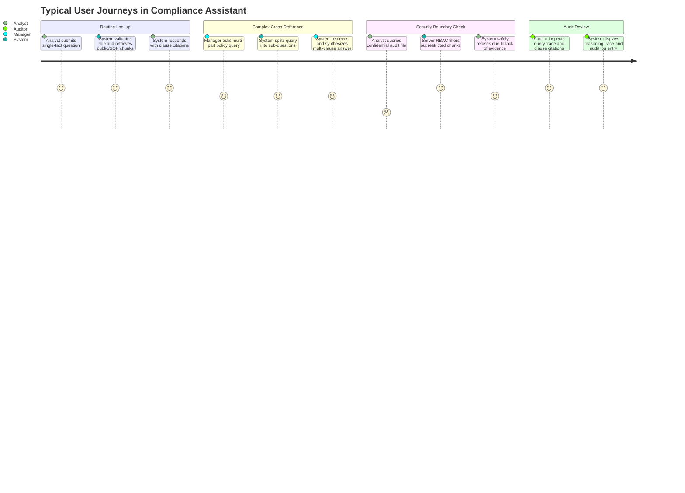

# Product Requirements Document (PRD)

**Project Title:** Enterprise RAG Assistant for Banking Regulatory Compliance  
**Module:** COM6301 (BSc Final Year Project)  
**Author / Candidate:** Hashir Khan  
**Status:** Frozen Scope Baseline (Updated with Profile-Driven LLM Gateway: dev / demo / mock)  
**Last Updated:** November 2026  

---

## 1. Problem Statement
Financial institutions face severe regulatory penalties and reputational risk for compliance failures. Regulatory texts (e.g., FCA Handbook, PRA guidelines, Basel III/IV frameworks) and internal operational policies are dense, heavily structured, cross-referenced, and frequently updated. Front-line compliance officers and risk analysts must navigate these corpora quickly while ensuring that:
1. Answers are strictly faithful to authoritative source documents.
2. Every statement is traceable to specific clauses and regulatory sections.
3. Access boundaries are preserved so staff only access documents authorized for their specific role.
4. Ambiguous or unsupported questions trigger polite refusals rather than hallucinations.

Standard RAG (naive vector search + single-shot LLM generation) fails in regulatory environments due to semantic drift, cross-reference blindness, lack of access control, retrieval of irrelevant chunks, and black-box generation lacking an audit trail.

---

## 2. Research Aim & Objectives
- **Primary Research Aim:** Design, implement, and empirically evaluate an enterprise RAG assistant that layers Adaptive Routing, Corrective Grading, Conversational Memory with Role-Based Access Control (RBAC), and Explainable AI (XAI) citations over a hybrid-search baseline.
- **Hypothesis:** Adding these targeted layers sequentially will demonstrably improve retrieval accuracy (Recall@k, MRR), answer faithfulness (RAGAS), and citation precision while eliminating unauthorized information leakage across roles, at an acceptable latency and token trade-off.

---

## 3. Users and Roles
The system operates on synthetic enterprise users mapped to three distinct organizational roles:

| Role Name | Description | Document Access Level | Example Query Permission |
| :--- | :--- | :--- | :--- |
| **Analyst** | Front-line compliance & operations analyst | Public regulations, standard internal operating procedures (SOPs). | Allowed: "What are the KYC threshold requirements under FCA MLR?" Blocked: "Show internal fraud committee investigation memos." |
| **Manager** | Compliance manager & team lead | Public regulations, internal SOPs, internal supervisory memos, audit remediation plans. | Allowed: "What is our remediation timeline for the 2025 liquidity audit?" Blocked: "Show executive whistleblowing case details." |
| **Auditor** | Internal/External regulatory auditor | Unrestricted read access across public regulations, SOPs, internal audit findings, and executive risk logs. | Allowed: "Compare 2025 liquidity remediation plans against internal whistleblowing disclosures." |

---

## 4. User Journeys

1. **Journey 1: Single-Fact Compliance Query (Analyst / Manager / Auditor)**
   - User inputs a factual query (e.g., minimum capital adequacy requirement).
   - System checks on-disk cache; if miss, executes hybrid retrieval over role-permitted chunks, cross-encoder re-ranking, passage grading, and generates a cited answer.
2. **Journey 2: Multi-Part Regulatory Analysis (Manager / Auditor)**
   - User asks a compound question requiring cross-referencing multiple rules.
   - Adaptive Router decomposes query into sub-questions, executes parallel hybrid searches, merges contexts, and generates an integrated synthesis.
3. **Journey 3: Out-of-Scope or Conversational Query (All Roles)**
   - User inputs a greeting ("Good morning") or general question.
   - Adaptive Router classifies query as direct-reply; responds immediately without executing retrieval.
4. **Journey 4: Unanswerable or Insufficient Information (All Roles)**
   - User queries a topic absent from the ingested corpus.
   - Retrieved chunks fail the Corrective Grader threshold; query rewriter retries once; if still irrelevant, system outputs a polite, standardized refusal.
5. **Journey 5: Role-Restricted Query Attempt (Analyst Attempting Manager-Level Data)**
   - Analyst queries internal supervisory notes.
   - Retrieval engine filters candidates strictly by `allowed_roles CONTAINS 'analyst'`.
   - Chunks are never fetched into LLM context; system returns a safe refusal without revealing the existence of restricted documents.

---

## 5. Functional Requirements (FR)

### Ingestion & Indexing
- **FR-1.1:** Support PDF and Markdown ingestion from `/data/raw` (public regulations) and `/data/synthetic` (internal policies).
- **FR-1.2:** Implement hierarchical, clause-aware chunking preserving section headers, article identifiers, and clause numbers.
- **FR-1.3:** Tag every chunk with metadata: `doc_id`, `doc_name`, `clause_id`, `section`, and `allowed_roles` (`['analyst', 'manager', 'auditor']`).

### Core RAG Engine (Baseline & Layers)
- **FR-2.1 (Baseline):** Hybrid retrieval combining dense vector search (`BAAI/bge-small-en-v1.5` on CPU) and sparse lexical search (BM25) via Reciprocal Rank Fusion (RRF).
- **FR-2.2 (Baseline):** Cross-encoder re-ranking (`cross-encoder/ms-marco-MiniLM-L-6-v2` on CPU) on top-$k$ candidates to produce final top-$n$ context.
- **FR-2.3 (Layer 1 - Adaptive Router):** Classify incoming queries into `DIRECT_REPLY`, `SINGLE_SEARCH`, or `MULTI_PART_SPLIT` using structured JSON output from LLM.
- **FR-2.4 (Layer 2 - Corrective Grader):** Grade retrieved passages (`RELEVANT` vs `IRRELEVANT`). If relevance is poor, rewrite query once and re-retrieve; if still poor, trigger polite refusal.
- **FR-2.5 (Layer 3 - Memory & RBAC):** Maintain multi-turn session history in SQLite. Filter all retrieval queries strictly by authenticated user role at the database/vector store level.
- **FR-2.6 (Layer 4 - XAI Output):** Produce structured answers containing clause citations (`[Doc Name, Section X.Y, Clause Z]`), formatted reasoning trace, and persistent audit log record in SQLite.
- **FR-2.7 (Ablation Toggles):** Independent configuration flags in `.env` to enable/disable each layer for scientific ablation experiments.

### LLM Gateway & Operations
- **FR-2.8 (Single LLM Wrapper):** All model calls (router, grader, rewrite, answer, judge) pass through one wrapper. It resolves its endpoint, key and model from `.env`; no other module reads credentials or model names.
- **FR-2.9 (Named Profiles):** `LLM_PROFILE` selects `dev` (free provider), `demo` (paid provider) or `mock` (fake LLM). Switching profile changes `.env` only — no code change, no rebuild.
- **FR-2.10 (Mock Default in Tests):** Automated tests run only under the `mock` profile, which returns deterministic canned router, grader and answer outputs. Tests must fail fast if a live profile is resolved.
- **FR-2.11 (Response Cache):** Repeated identical calls are served from an on-disk cache keyed by model, prompt and parameters (including temperature, max tokens and prompt version). Cache hits cost zero quota.
- **FR-2.12 (Spend Guard):** A configurable cap on calls and tokens per run stops execution before overspend and emits a clear budget-exhausted message. Per-call token usage is recorded in the audit/metrics tables.
- **FR-2.13 (Strict Structured Steps):** Router and grader responses are validated with strict Pydantic models, get exactly one repair retry, then fall back safely (router: `SINGLE_SEARCH`; grader: keep all passages).
- **FR-2.14 (Versioned Prompts):** All prompts live in `prompts/<step>/vN.md` with a version tag; the active version is configured and recorded in the cache key and audit log.
- **FR-2.15 (Profile Smoke Test):** `scripts/smoke_demo.py` runs 10 representative questions end to end and reports pass/fail, latency and tokens for any selected profile.

---

## 6. Non-Functional Requirements (NFR)

- **NFR-1 (Single LLM Gateway & Profiles):** All LLM traffic flows through one OpenAI-compatible wrapper configured from `.env`. It supports three named profiles — `dev` (free-tier provider), `demo` (paid provider) and `mock` (deterministic fake) — selected by `LLM_PROFILE` without code changes. `dev` reads `LLM_BASE_URL`, `LLM_API_KEY`, `LLM_MODEL`; `demo` reads `DEMO_LLM_BASE_URL`, `DEMO_LLM_API_KEY`, `DEMO_LLM_MODEL`; `mock` needs no network or key.
- **NFR-2 (Resilience, Cache & Spend Guard):** The wrapper enforces 15s timeouts, exponential backoff with jitter, a client-side token bucket, and an on-disk cache keyed by model + prompt + parameters. A configurable per-run cap on calls and tokens stops execution with a clear message instead of overspending, and token usage per call is logged to the audit/metrics tables.
- **NFR-3 (Local CPU Models):** Embeddings (`bge-small-en-v1.5`) and re-ranking (`ms-marco-MiniLM-L-6-v2`) must execute locally on CPU with low memory footprint (~300MB RAM), operating without a dedicated GPU.
- **NFR-4 (Security & RBAC Enforcement):** Role filtering must execute inside Qdrant vector retrieval payload filters. Zero unauthorized tokens in LLM context.
- **NFR-5 (Prompt Injection Safety):** Retrieved text must be delimited as data blocks (`<authoritative_documents>...</authoritative_documents>`), explicitly instructed never to execute instructions embedded within text.
- **NFR-6 (Data Validation & Secrets Hygiene):** API inputs validated with Pydantic v2. Router and grader JSON validated strictly, with one repair retry then safe fallback. SQL queries parameterized. `.env` added to `.gitignore`. Never log API keys, auth headers, or full prompts.
- **NFR-7 (Auditability):** Every query must record an immutable audit log entry in SQLite containing timestamp, user ID, role, prompt, retrieved chunk IDs, relevance score, generated response, latency, token metrics and the active LLM profile.
- **NFR-8 (Prompt Versioning):** Prompts are stored in a single `prompts/` folder with explicit version tags, and the active prompt version is reproducible in cache entries and audit records.
- **NFR-9 (Zero Test Spend):** Automated tests must use the `mock` profile exclusively and spend exactly 0 external tokens.

---

## 7. Scope Boundaries

### In Scope (Frozen Core)
1. Baseline Hybrid RAG (BM25 + Vector Search + Cross-Encoder Re-ranker).
2. Layer 1: Adaptive Router (direct reply, single search, query decomposition).
3. Layer 2: Corrective Grader (passage relevance grading, single query rewrite retry, polite refusal).
4. Layer 3: Memory (SQLite session context) + RBAC (role metadata retrieval filtering).
5. Layer 4: XAI Output (clause citations, reasoning trace, SQLite audit log).
6. Local evaluation harness using RAGAS against cloud API model (batched, cached, rate-limited) and custom benchmark scripts.
7. Streamlit multi-role web demo.

### Stretch Scope (Do NOT build unless explicitly requested)
- Prompted claim-by-claim self-check (Self-RAG critic layer).
- External calculator tool for regulatory capital ratio arithmetic.

### Out of Scope (Explicitly Excluded)
- Knowledge graphs (GraphRAG / HybridAI RAG).
- Multi-vector attention mechanisms (ColBERT / Attention-based RAG).
- Cloud deployment (AWS, GCP, Azure, Docker Swarm / Kubernetes).
- Third-party SSO / OAuth (Auth0, Okta, Active Directory).
- Dynamic document ingestion UI with OCR for scanned files.

---

## 8. Success Criteria

| Objective | Target Metric | Verification Method |
| :--- | :--- | :--- |
| **Access Isolation** | **0.00% Leakage Rate** | Automated security test: Analyst queries Manager-only policies; zero chunks retrieved. |
| **Retrieval Efficacy** | Recall@5 $\ge 0.85$, MRR $\ge 0.75$ | Benchmark test against 100-question gold set. |
| **Answer Quality** | Faithfulness $\ge 0.85$, Relevance $\ge 0.80$ | RAGAS evaluation with cloud LLM judge + manual sample verification. |
| **Citation Precision** | $\ge 90\%$ of cited clauses accurately match gold sources | Automated regex match against ground-truth clause IDs. |
| **Refusal Accuracy** | $\ge 95\%$ correct refusals on unanswerable/out-of-corpus queries | Corrective grader ablation test against unanswerable subset. |
| **System Latency** | Fast path $< 1.5\text{s}$, Standard RAG $< 6\text{s}$ | Automated latency tracking in SQLite audit log. |
| **Test Quota Spend** | **Strictly 0 tokens spent in tests** | All unit and integration tests execute under the `mock` profile. |
| **Profile Switch** | Switching `mock` → `dev` → `demo` requires no code change | Startup config test: only `.env` / `--profile` differs; resolved provider, model and key change accordingly. |
| **Spend Control** | Never exceed configured per-run calls or tokens | Spend-guard unit tests plus audit metrics reconcile calls/tokens per run. |
| **Profile Smoke Test** | 10/10 representative questions pass in under 2 minutes | `python scripts/smoke_demo.py --profile <name>` exits 0 and prints latency/tokens. |

---

## 9. Assumptions & Open Decisions

### Assumptions Made
- The local environment runs Python 3.12 without requiring a local LLM or GPU.
- The `dev` free-tier API key provides sufficient rate limits for development when paired with on-disk response caching.
- The `demo` paid key is only used deliberately for demonstrations and final evaluation runs.
- Qdrant embedded mode provides fast, serverless vector storage with native payload filtering.

### Open Decisions
- Which concrete free-tier provider backs `dev` and which paid provider backs `demo`; both are chosen in `.env`.
