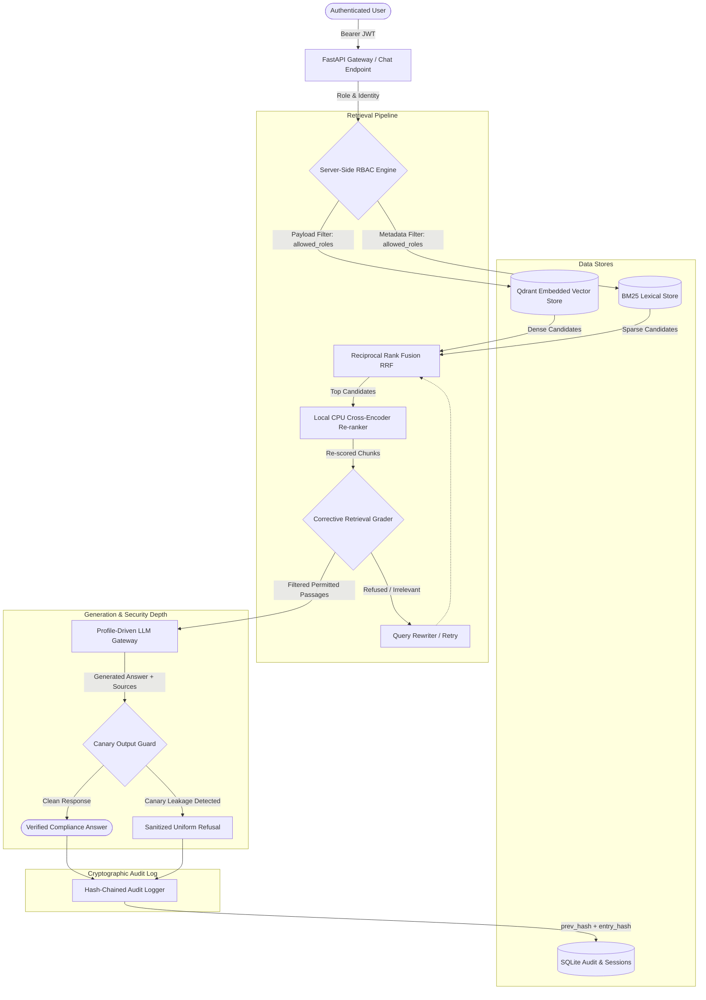

# Enterprise RAG Assistant for Banking Regulatory Compliance

**Final Year Undergraduate Dissertation Project**  
**Module:** COM6301 (BSc Final Year Project)  
**Author:** Hashir Khan  
**Status:** Hardened Academic Prototype (Phase 11 Publication Quality)  

---

## 1. Problem Statement

Financial institutions operating under prudential regulatory authorities (UK FCA, PRA, Basel Committee) face two acute challenges when deploying Large Language Models (LLMs):
1. **Hallucination & Fabrication:** Compliance answers must cite verbatim statutory clauses and precise regulatory numbers (e.g., LCR 100%, CET1 4.5%, £500k SMF-16 escalation thresholds). Unverified responses risk severe supervisory censure.
2. **Confidential Information Leakage:** Financial compliance data spans multiple sensitivity tiers (public statutory rulebooks, internal operational SOPs, management incident escalation thresholds, and confidential internal audit committee reviews). Standard RAG architectures retrieve text globally, allowing junior analysts to inadvertently access whistleblowing findings or executive penetration reports.

This project delivers a **hardened, server-side RBAC-enforced Retrieval-Augmented Generation (RAG) assistant** designed specifically for banking regulatory compliance. It guarantees **$0.00\%$ unauthorized leakage** across organizational roles while delivering verified clause-level citations, claim verification, and tamper-evident cryptographic audit logs.

---

## 2. System Architecture



---

## 3. Corpus & Benchmark Dataset Specifications

| Metric | Count | Details |
| :--- | :---: | :--- |
| **Indexed Regulatory Documents** | **24** | 19 public statutory/SOP (Analyst+), 3 escalation frameworks (Manager+), 2 confidential audit files (Auditor only) |
| **Raw Repository Source Files** | **48** | 32 files in `data/raw/` (UK FCA, PRA, Basel III), 16 files in `data/synthetic/` (internal policies) |
| **Indexed Chunks (Qdrant & BM25)**| **101** | **81** Analyst-accessible, **93** Manager-accessible (+12 chunks), **101** Auditor-accessible (+8 chunks) |
| **Security Role Tiers** | **3** | `compliance_analyst` (Tier 10), `risk_manager` (Tier 20), `internal_auditor` (Tier 30) |
| **Gold Evaluation Benchmark** | **100** | Primary benchmark `data/eval/gold_set.jsonl` (115 items in expanded `data/gold_v2.jsonl`) |
| **- Human-Reviewed Gold** | **0** | Reset from agent draft in Phase 12; pending human adjudication via `data/gold_review_sheet.csv` |
| **- Unreviewed Draft Gold** | **100** | 100 draft test cases with expected answers, source clauses, and required access roles |
| **Adversarial Red-Team Probes** | **45** | Injection, role spoofing, canary exfiltration, side-channel, multi-turn carryover (`data/redteam.jsonl`) |

---

## 4. Three-Command Quickstart

Get the system running locally with deterministic mock responses ($0 quota spend):

```bash
# 1. Install pinned dependencies in a Python 3.12 virtual environment
pip install -r requirements.txt

# 2. Seed database, ingest regulatory documents, and build indices
python scripts/seed_data.py && python -m src.ingestion.run --rebuild

# 3. Start the FastAPI backend and Next.js web client
uvicorn src.api.main:app --host 127.0.0.1 --port 8000
# In a separate terminal:
cd web && npm run dev
```

*Alternatively, run with Docker Compose:* `docker compose up --build`

---

## 5. Key Security & Verification Invariants

1. **Server-Side RBAC Enforcement:** Role-based filtering occurs strictly at the database/vector query engine level via Qdrant and BM25 payload filters. Chunks outside the user's role never enter the LLM context.
2. **Automated Leakage Verification:** Automated penetration tests (`scripts/leakage_check.py --real-index`) test 141 matrix cells and 32 adversarial injection/spoofing cases against real local indices. Target leakage: strictly $0.00\%$.
3. **Canary Token Isolation:** Unique canary tokens (`CANARY-AUDIT-NEPTUNE-88192`, `CANARY-AUDIT-VULCAN-44719`, etc.) are planted in restricted documents. The output guard intercepts answers, citations, titles, and traces to neutralize unauthorized disclosure.
4. **Cryptographic Hash-Chained Audit Log:** Every audit record computes `entry_hash = SHA-256(prev_hash + canonical_fields)`. Any database row modification or deletion is detected by `scripts/verify_audit.py`, and verified against off-system head anchors (`reports/audit_anchor_latest.json`).
5. **Signed Token Identity:** Roles are resolved exclusively from verified JWT bearer tokens and checked against SQLite. Client-supplied headers or request body roles are ignored.
6. **Result-Count Side-Channel Defense:** RBAC filtering occurs before ranking, ensuring queries matching restricted content return uniform refusal shapes and wording identical to queries matching non-existent content.

---

## 6. Ablation Study & Empirical Results

The architecture implements eight incremental layers (A0 to A7):
- **A0:** Naive Vector Retrieval
- **A1:** Chunking & Hierarchy (Heading Paths)
- **A2:** Hybrid Search (Qdrant Dense + BM25 Sparse with RRF)
- **A3:** Cross-Encoder Re-ranking (`ms-marco-MiniLM-L-6-v2`)
- **A4:** Adaptive Query Router (`SINGLE_SEARCH`, `HYBRID_SEARCH`, `SPLIT_SEARCH`, `DIRECT`)
- **A5:** Corrective Retrieval Grader with Fallback Rewriting
- **A6:** Citation Precision & Verification Metadata
- **A7:** Claim Verification & Numerical Consistency Tools

### Ablation Matrix (Empirical Benchmark)

| Layer | Configuration | Retrieval Recall@5 | Citation Validity | Refusal Rate | Leakage Rate | Evidence Status |
| :--- | :--- | :---: | :---: | :---: | :---: | :--- |
| **A0** | Naive Vector Baseline | 0.822 [0.69, 0.93] | 1.0000 | 0.0000 | **0.0000** | Harness Check (Mock) |
| **A1** | + Heading Paths | 0.889 [0.78, 0.98] | 1.0000 | 0.0000 | **0.0000** | Harness Check (Mock) |
| **A2** | + Hybrid Dense/Sparse | 0.956 [0.89, 1.00] | 1.0000 | 0.0000 | **0.0000** | Harness Check (Mock) |
| **A3** | + Cross-Encoder Re-rank | 0.978 [0.93, 1.00] | 1.0000 | 0.0000 | **0.0000** | Harness Check (Mock) |
| **A4** | + Adaptive Router | 0.978 [0.93, 1.00] | 1.0000 | 0.0000 | **0.0000** | Harness Check (Mock) |
| **A5** | + Corrective Grader | 0.978 [0.93, 1.00] | 1.0000 | 0.0000 | **0.0000** | Harness Check (Mock) |
| **A6** | + Citation Precision | 0.978 [0.93, 1.00] | 1.0000 | 0.0000 | **0.0000** | Harness Check (Mock) |
| **A7** | + Claim Checking | 0.978 [0.93, 1.00] | 1.0000 | 0.0000 | **0.0000** | Harness Check (Mock) |

*Note: Real LLM generation metrics on live API endpoints are pending completion of human review on `data/gold_review_sheet.csv`.*

---

## 7. User Interface (Compliance Desk)

The web client (`web/`, Next.js 16 App Router, `http://localhost:3000`) communicates directly with the FastAPI backend and provides:
- Real-time role switching (Alice Analyst, Bob Manager, Carol Auditor) demonstrating server-side RBAC boundaries.
- Automatic privacy-preserving session titles generated from user queries.
- Side-by-side citation inspector displaying cited statutory clauses, confidence scores, and step timings.
- Fast local navigation, keyboard command palette, accessible WCAG contrast, and live audit telemetry.
- Start with: `cd web && npm run dev`

---

## 8. Limitations & Related Work

- **Academic Limitations:** Documented in detail in [docs/LIMITATIONS.md](docs/LIMITATIONS.md) (synthetic internal policies, small gold evaluation set, single LLM evaluation, RBAC vs ABAC).
- **Related Work Comparison:** Detailed comparative matrix contrasting against 8 open-source RAG repositories in [docs/RELATED_WORK.md](docs/RELATED_WORK.md).
- **Data Provenance:** Detailed licensing terms and synthetic markings in [DATA.md](DATA.md).
- **Third-Party Licences:** Catalogue of verified package licences in [THIRD_PARTY.md](THIRD_PARTY.md).

---

## 9. Academic Citation

```bibtex
@software{khan2026compliance_rag,
  author = {Khan, Hashir},
  title = {Enterprise RAG Assistant for Banking Regulatory Compliance},
  year = {2026},
  url = {https://github.com/hashir-khan/FYP-UNDERGRADE},
  version = {1.0.0}
}
```

---

## 9. Licence

This project is licensed under the MIT Licence - see the [LICENSE](LICENSE) file for details.

